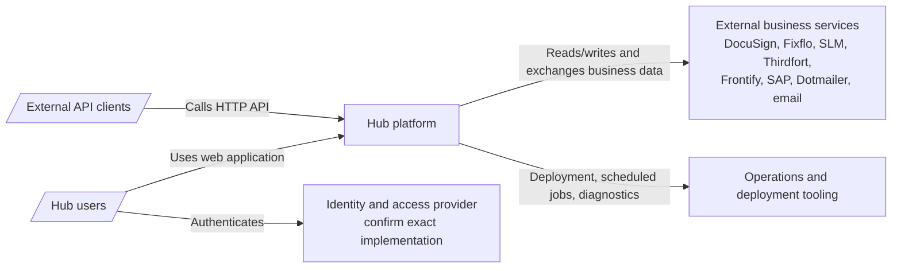
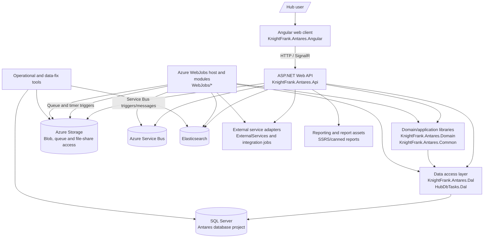
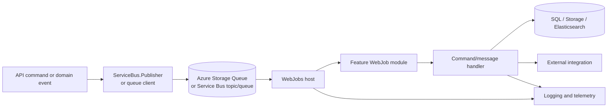
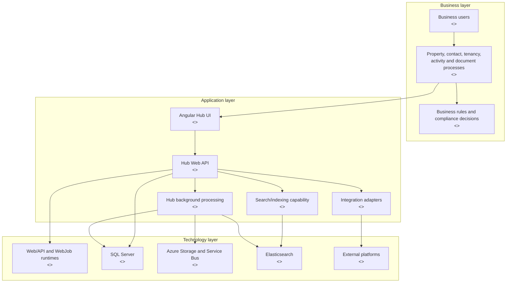

# Hub architecture blueprint

## Status

**In progress - source-derived baseline with first-pass inventories and flows**

This blueprint was produced from the repository at `C:\Source\Devops\KnightFrank.hub`. It describes the architecture visible in source code and project files; it is not yet a production deployment diagram. Hosting topology, network boundaries, data ownership, and operational responsibilities must be confirmed against the deployment configuration and Azure resources.

## Scope and goals

The Hub is a business application platform with:

- an Angular web client;
- an ASP.NET Web API facade;
- domain, data-access, and shared infrastructure libraries;
- SQL Server persistence;
- asynchronous processing through Azure WebJobs, Azure Storage queues, and Azure Service Bus;
- document and image storage in Azure Storage;
- search and indexing through Elasticsearch;
- integrations with external services such as DocuSign, Fixflo, SLM, Thirdfort, Frontify, email, SAP, and Dotmailer;
- scheduled, batch, and operational tools;
- reporting and deployment assets.

The initial documentation scope is Hub only. Azure service-specific documentation should be created later in separate service folders after this baseline has been reviewed.

## Evidence used

| Area | Source evidence |
|---|---|
| Web client | `src/KnightFrank.Antares.Angular/package.json` |
| API surface | `src/KnightFrank.Antares.Api/Controllers/` |
| API composition | `src/KnightFrank.Antares.Api/App_Start/AutofacConfiguration.cs` |
| Domain and persistence | `src/KnightFrank.Antares.Domain/`, `src/KnightFrank.Antares.Dal/`, `src/KnightFrank.Antares.Database/` |
| Background processing | `src/WebJobs/` and `src/KnightFrank.Antares.WebJobsLocalService/` |
| Queue and Service Bus contracts | `src/Hub.Contracts/` and `src/KnightFrank.Antares.ServiceBus.Publisher/` |
| Azure Storage | `src/KnightFrank.Antares.Common.Azure/Services/AzureStorage/` |
| External integrations | `src/KnightFrank.Antares.ExternalServices/` and WebJob integration projects |
| Search | `src/KnightFrank.Antares.Search/`, `src/KnightFrank.Antares.SearchToFile/`, and Elasticsearch WebJobs |
| Reports and operations | `src/KnightFrank.Antares.Reports/`, `BuildDeploy/`, and `tools/` |

## Architecture summary

Hub is best treated as a **modular business platform with synchronous and asynchronous execution paths**, rather than as a single application:

1. Users and external clients call the Web API through the Angular application or other API consumers.
2. The API resolves application services through Autofac and uses domain logic, the DAL, SQL Server, search, storage, and external-service adapters.
3. API operations publish work to queues or Service Bus when processing is asynchronous or integration-driven.
4. Azure WebJobs consume queue, Service Bus, and timer-triggered work. They perform notifications, documents, feeds, compliance-related updates, search indexing, messaging, and external integrations.
5. Shared contracts define message subjects and trigger constants so publishers and consumers can interoperate.

## C4 system context

The following is a C4-style system-context view. Relationships are based on repository evidence; the precise external system names and trust boundaries remain to be confirmed.

## C4 container view

Containers here represent deployable or independently hosted runtime areas visible in the repository. Several WebJob projects may be deployed together or separately; deployment configuration must confirm the final grouping.

## Component view: asynchronous processing

This view shows the recurring asynchronous pattern. The exact queue names, retry policies, dead-letter handling, and idempotency guarantees should be documented per process.

## ArchiMate-inspired layered view

This view uses ArchiMate concepts as labels while using Mermaid for portability in Obsidian. It is intended to be converted to a formal ArchiMate model once business actors, capabilities, and deployment nodes are confirmed.

## Key architectural characteristics

- **Synchronous API path:** Angular and other clients call a broad controller surface in the Web API.
- **Shared domain path:** API and WebJobs both reference shared domain/common code, so changes to domain behaviour can affect both interactive and background processing.
- **Asynchronous integration:** Queue and Service Bus messages decouple API work from long-running, scheduled, or integration-heavy processes.
- **Document-centric storage:** Azure Storage abstractions cover blobs, queues, and file shares, including document, image, video, template, and certificate resources.
- **Search projection:** Elasticsearch is a separate search/indexing concern and should be documented as a projection of authoritative business data, unless source analysis proves otherwise.
- **Modular background jobs:** WebJob projects are feature-oriented, including email, notifications, documents, feeds, SAP, Thirdfort, Elasticsearch, tenancy, and compliance-related processing.
- **Legacy and modern technology coexistence:** The repository contains .NET Framework projects and an Angular 19 client, so runtime and deployment compatibility needs explicit documentation.

