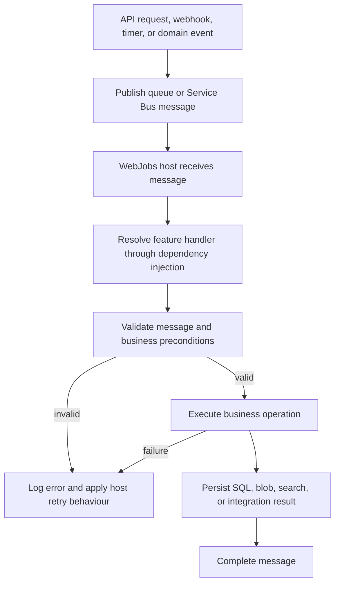
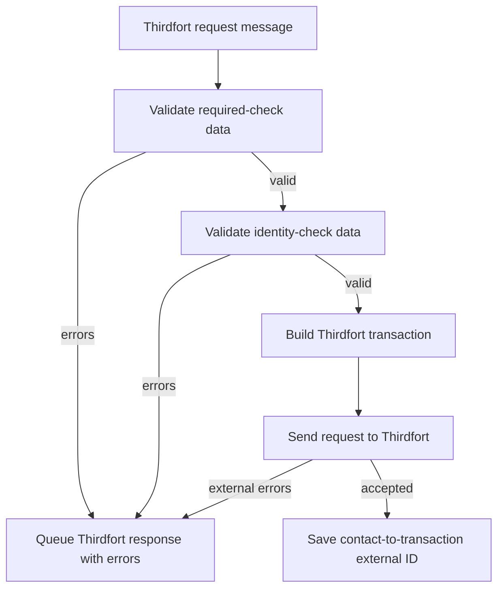
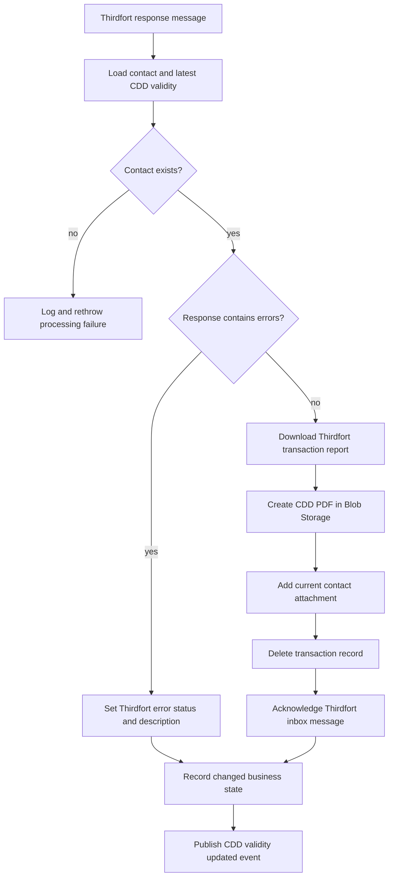
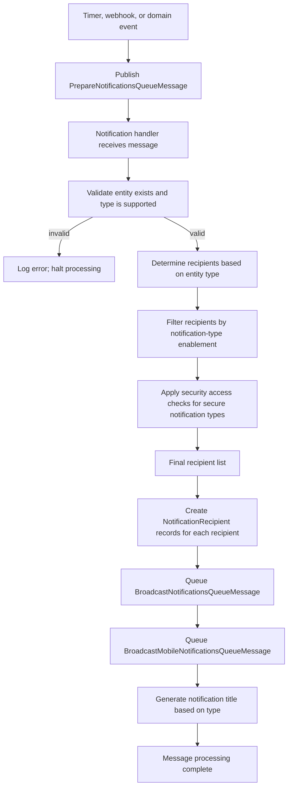
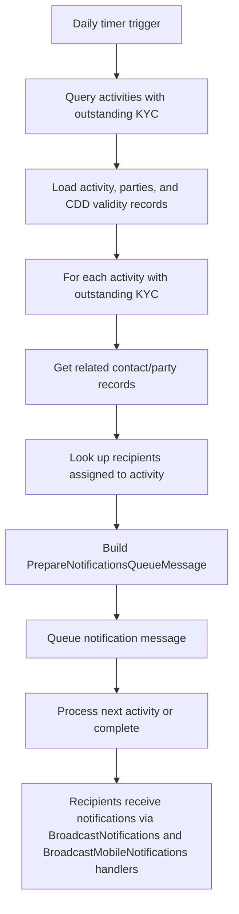
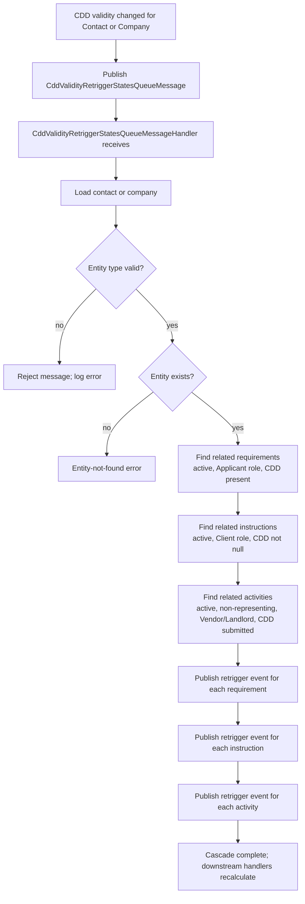
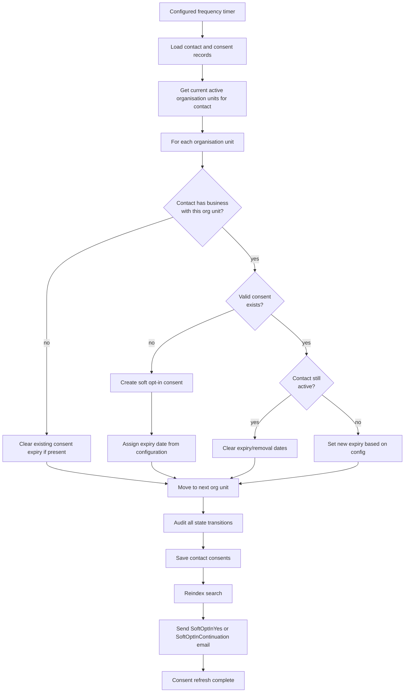
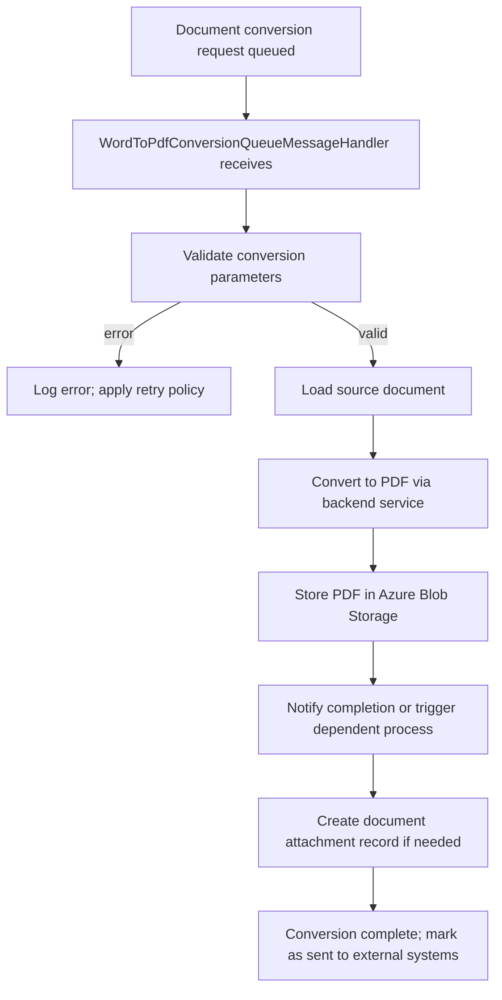

# Hub process flows

## Status

These are source-derived first-pass flows. They document confirmed behaviour for the Thirdfort asynchronous journey and several high-value business processes. Additional flows are required for property, contact, and remaining integration journeys.

## Generic asynchronous processing

## Thirdfort request

Source: `src/WebJobs/KnightFrank.Antares.WebJobs.Thirdfort/MessageHandlers/ThirdfortRequestQueueMessageHandler.cs`.

## Thirdfort response and report

Source: `src/WebJobs/KnightFrank.Antares.WebJobs.Thirdfort/MessageHandlers/ThirdfortResponseQueueMessageHandler.cs`.

## Notification preparation and delivery

Source: `src/WebJobs/KnightFrank.Antares.WebJobs.Notifications/MessageHandlers/PrepareNotificationsQueueMessageHandler.cs`.

## Activity notification flow (example: outstanding KYC)

Source: `src/WebJobs/KnightFrank.Antares.WebJobs/CommandHandlers/ActivityOutstandingKycTobCommandHandler.cs`.

## CDD validity retriggering cascade

Source: `src/WebJobs/KnightFrank.Antares.WebJobs.CddValidity/MessageHandlers/CddValidityRetriggerStatesQueueMessageHandler.cs`.

## Soft opt-in consent refresh cycle

Source: `src/WebJobs/KnightFrank.Antares.WebJobs.SoftOptIn/CommandHandlers/SoftOptInCommandHandler.cs`.

## Document-to-PDF conversion and storage

Source: `src/WebJobs/KnightFrank.Antares.WebJobs/MessageHandlers/WordToPdfConversionQueueMessageHandler.cs`.

## Process documentation gaps

- Entry points for the main property contact-change and churn-risk journeys.
- Requirement auto-match and scheduled notification flow.
- Tenancy lifecycle flow (SLM sync, Fixflo tenancy-started/ended, churn-risk updates, out-of-hours archival).
- Brochure generation flow (request → Frontify → completion → delivery).
- Integration result handlers (HomePpl, TDS, Qube synchronization).
- User reassignment flow (task transfer, tenancy role updates).
- Email delivery flow (queuing, batch Exchange operations, consent/suppression checks).
- Search indexing and projection consistency flow.
- User-visible outcomes and SLAs for each process.
- Retry, poison-message, and dead-letter paths for each process.
- Compensating actions when an external service succeeds but local persistence fails.
- Process owners and operational runbooks.

