# Hub process flows

## Status

These are source-derived first-pass flows. They document confirmed behaviour for the Thirdfort asynchronous journey and several high-value business processes. Additional flows are required for property, contact, and remaining integration journeys.

## Generic asynchronous processing

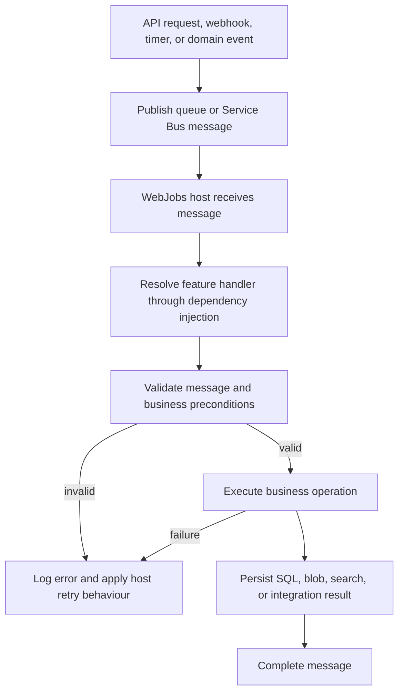

## Thirdfort request

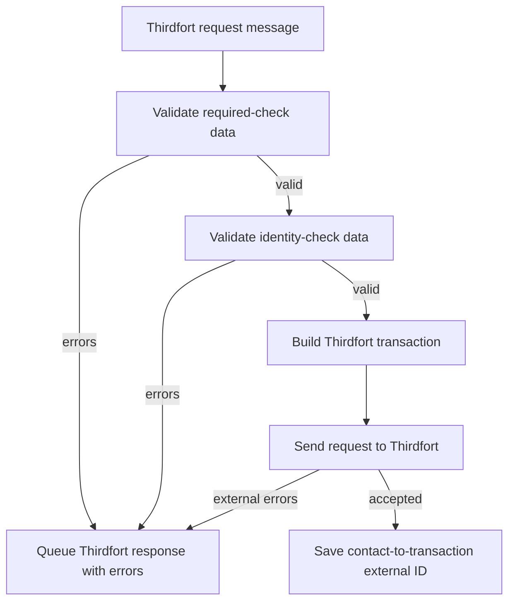

Source: `src/WebJobs/KnightFrank.Antares.WebJobs.Thirdfort/MessageHandlers/ThirdfortRequestQueueMessageHandler.cs`.

## Thirdfort response and report

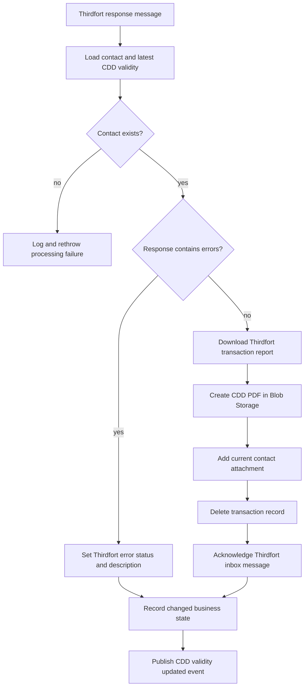

Source: `src/WebJobs/KnightFrank.Antares.WebJobs.Thirdfort/MessageHandlers/ThirdfortResponseQueueMessageHandler.cs`.

## Notification preparation and delivery

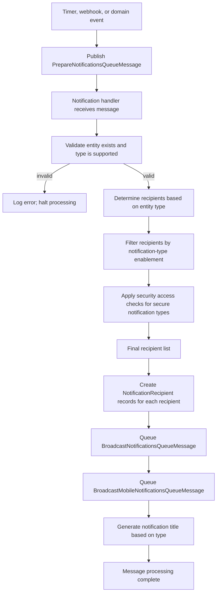

Source: `src/WebJobs/KnightFrank.Antares.WebJobs.Notifications/MessageHandlers/PrepareNotificationsQueueMessageHandler.cs`.

## Activity notification flow (example: outstanding KYC)

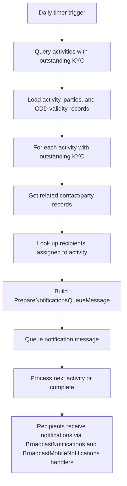

Source: `src/WebJobs/KnightFrank.Antares.WebJobs/CommandHandlers/ActivityOutstandingKycTobCommandHandler.cs`.

## CDD validity retriggering cascade

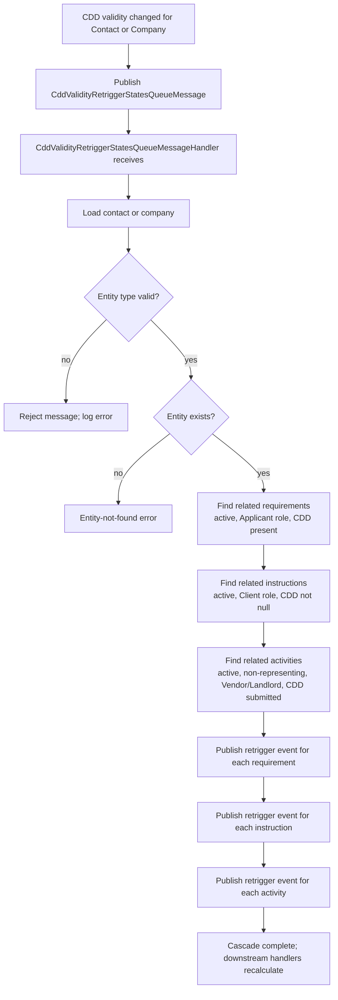

Source: `src/WebJobs/KnightFrank.Antares.WebJobs.CddValidity/MessageHandlers/CddValidityRetriggerStatesQueueMessageHandler.cs`.

## Soft opt-in consent refresh cycle

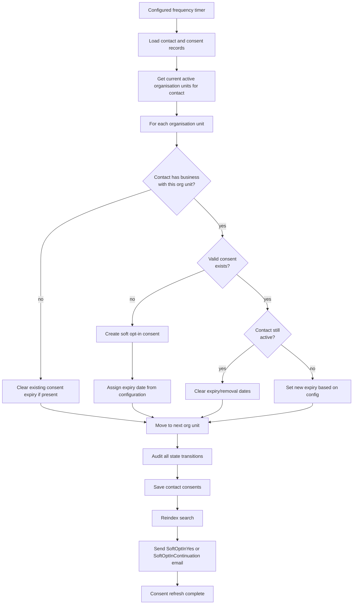

Source: `src/WebJobs/KnightFrank.Antares.WebJobs.SoftOptIn/CommandHandlers/SoftOptInCommandHandler.cs`.

## Document-to-PDF conversion and storage

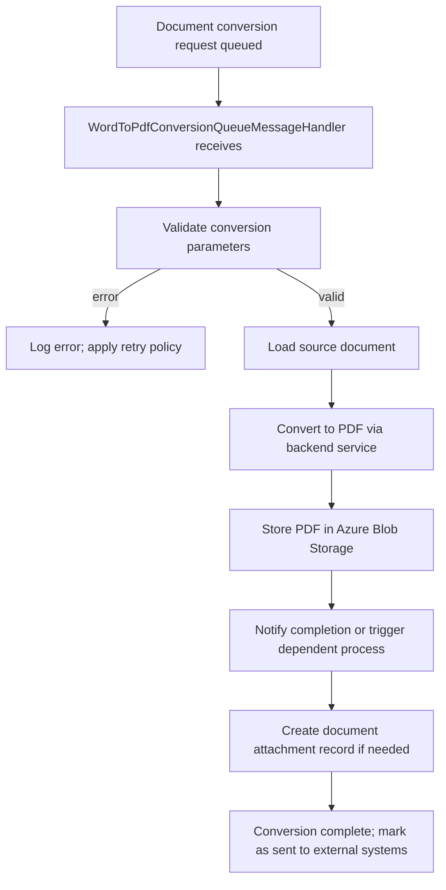

Source: `src/WebJobs/KnightFrank.Antares.WebJobs/MessageHandlers/WordToPdfConversionQueueMessageHandler.cs`.

## Tenancy lifecycle integrations

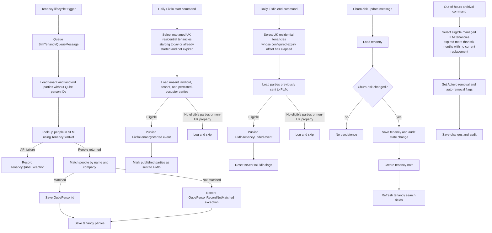

Sources:

- `src/WebJobs/KnightFrank.Antares.WebJobs.SlmTenancy/Services/SlmTenancyService.cs`
- `src/WebJobs/KnightFrank.Antares.WebJobs/CommandHandlers/Tenancy/Started/Fixflo/PublishFixfloTenancyStartedEventWithStartingDateCommandHandler.cs`
- `src/WebJobs/KnightFrank.Antares.WebJobs/CommandHandlers/Tenancy/Ended/Fixflo/PublishFixfloTenancyEndedEventWithEndingDateCommandHandler.cs`
- `src/WebJobs/KnightFrank.Antares.WebJobs/MessageHandlers/UpdateTenancyChurnRiskStatusQueueMessageHandler.cs`
- `src/WebJobs/KnightFrank.Antares.WebJobs/CommandHandlers/RemoveExpiredTenanciesFromOutOfHoursCommandHandler.cs`

## Brochure generation and completion

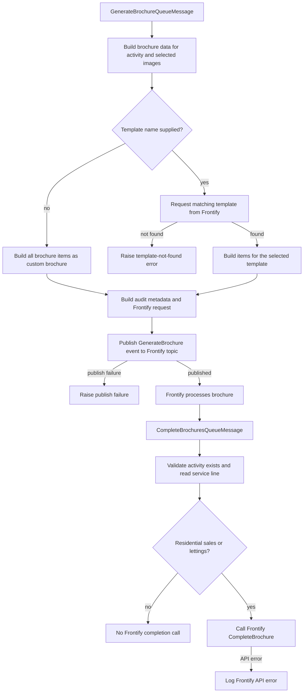

Sources:

- `src/WebJobs/KnightFrank.Antares.WebJobs/MessageHandlers/GenerateBrochureQueueMessageHandler.cs`
- `src/WebJobs/KnightFrank.Antares.WebJobs/MessageHandlers/CompleteBrochuresQueueMessageHandler.cs`

The inspected handlers publish the request and invoke Frontify completion. PDF storage and delivery notification are not implemented in these two handlers and require tracing elsewhere.

## Integration result handlers

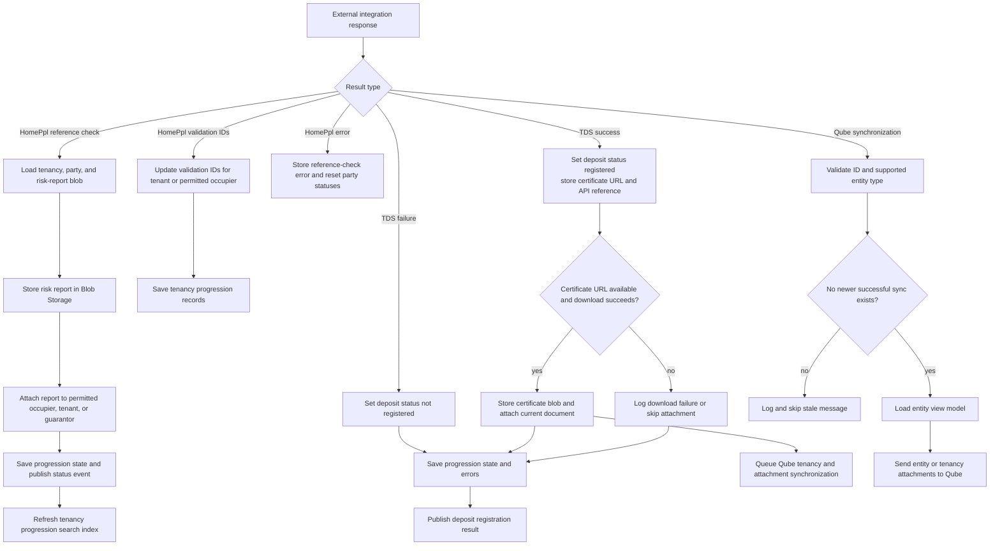

Sources:

- `src/WebJobs/KnightFrank.Antares.WebJobs/MessageHandlers/HomePplResultQueueMessageHandler.cs`
- `src/WebJobs/KnightFrank.Antares.WebJobs/MessageHandlers/TDSResultQueueMessageHandler.cs`
- `src/WebJobs/KnightFrank.Antares.WebJobs/MessageHandlers/QubeSynchronizationQueueMessageHandler.cs`

## Email consent, suppression, and delivery

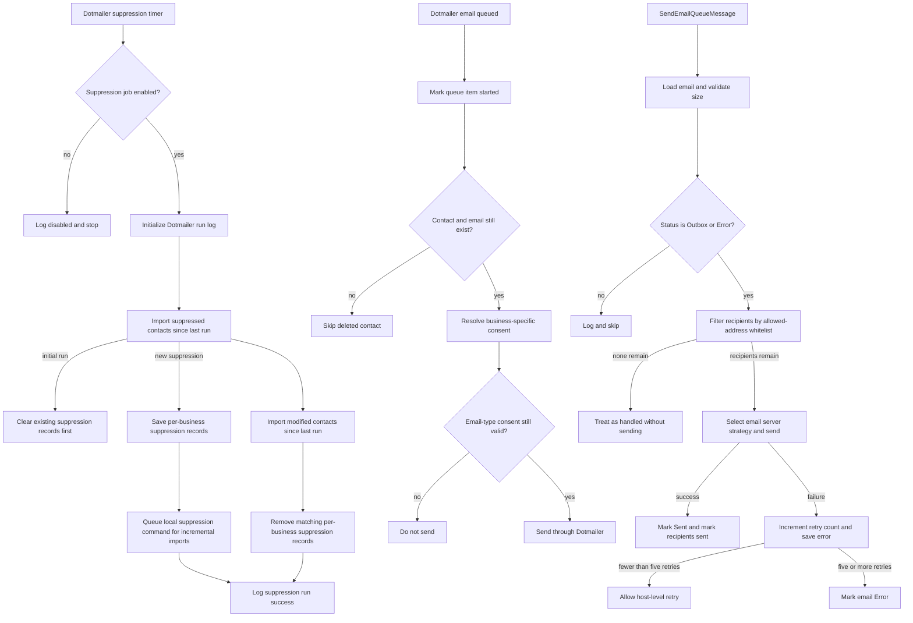

Sources:

- `src/WebJobs/KnightFrank.Antares.DotmailerWebJob/Suppressions/DotmailerSuppressionsManager.cs`
- `src/WebJobs/KnightFrank.Antares.DotmailerWebJob/Suppressions/Steps/Unsubscribes/UnsubscribesStepRunner.cs`
- `src/WebJobs/KnightFrank.Antares.DotmailerWebJob/Suppressions/Steps/Resubscribes/ResubscribesStepRunner.cs`
- `src/WebJobs/KnightFrank.Antares.DotmailerWebJob/Emails/Handlers/BaseEmailHandler.cs`
- `src/WebJobs/KnightFrank.Antares.WebJobs.Email/MessageHandlers/SendEmailQueueMessageHandler.cs`

## Process documentation gaps

- Entry points for the main property contact-change and churn-risk journeys.
- Requirement auto-match and scheduled notification flow.
- User reassignment flow (task transfer, tenancy role updates).
- Search indexing and projection consistency flow.
- User-visible outcomes and SLAs for each process.
- Retry, poison-message, and dead-letter paths for each process.
- Compensating actions when an external service succeeds but local persistence fails.
- Process owners and operational runbooks.

