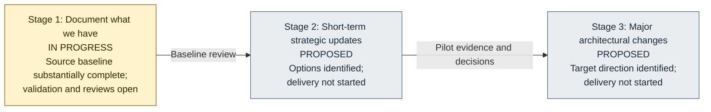

# Hub project plan and next steps

This is the actionable project backlog, organized into three stages. Completed
documentation is recorded in [TASK-COMPLETION-SUMMARY.md](./TASK-COMPLETION-SUMMARY.md);
current status is maintained in [README.md](./README.md). Record completed
documentation checks in the [verification register](./TASK-COMPLETION-SUMMARY.md#verification-register).

## Project progress

### Stage 1 completeness

| Checkpoint | Status | What remains |
|---|---|---|
| Current-state source documentation | Substantially complete | Selected additional handler and error-path coverage remains optional follow-up. |
| GUI source-derived contract, P0-P3 | Complete for source review | Product and accessibility review remains open. |
| Production configuration and transports | Partial | Confirm production hosting, naming and operational transport policies. |
| Business and technical validation | Not started | Obtain SME review and approval of documented behaviour. |
| Operations handoff | Not started | Confirm ownership, monitoring, security, service levels and recovery. |

This visual shows **status, not a calculated completion percentage**. Discovery
for later stages can happen in parallel; the arrows show the intended sequence
and decisions, not a prohibition on preparatory work. See the
[verification register](./TASK-COMPLETION-SUMMARY.md#verification-register)
for evidence and outstanding confirmations.

## Stage 1: Document what we have

**Status:** In progress. Source-derived coverage is substantially complete,
but production validation and review remain open.

### 1. Production transport confirmation — high priority

**Status:** Blocked on DevOps / Operations input

- Verify that deployment parameters or environment settings replace only the `local`/`dev` environment token with `prd`, preserving the remaining CAF name components.
- Map production topics to subscriptions and consumer modules.
- Record retry counts, visibility timeouts, dead-letter handling, and poison-message policy.
- Record idempotency and duplicate-message guarantees.

**Deliverable:** Production section in [message-transport-inventory.md](../Architecture%20%26%20Infrastructure/message-transport-inventory.md).

### 2. Subject-matter expert review — high priority

**Status:** Pending reviewer availability

- Review [CORE-DOMAIN.md](../Core%20Business%20Domain/CORE-DOMAIN.md).
- Review [API-WORKFLOWS.md](../Core%20Business%20Domain/API-WORKFLOWS.md).
- Review [STATE-MACHINES-VALIDATORS.md](../Core%20Business%20Domain/STATE-MACHINES-VALIDATORS.md).
- Review [business-rules.md](../Architecture%20%26%20Infrastructure/business-rules.md) and [process-flows.md](../Architecture%20%26%20Infrastructure/process-flows.md).
- Record corrections, approved behavior, and rules that remain implementation assumptions.

**Deliverable:** Review notes and approval status.

### 3. Operations handoff — high priority

**Status:** Blocked on production configuration and operations input

- Document monitoring, dashboards, alerts, ownership, and escalation paths.
- Document SLAs and acceptable processing latency.
- Document security, authentication, authorization, and secret-management responsibilities.
- Document deployment gates, rollback, incident response, and troubleshooting runbooks.

**Deliverable:** Operations section in the architecture documentation plus linked runbooks.

### 4. Complete source-derived coverage — medium priority

**Status:** Optional follow-up after the high-priority items

- Add activity and requirement handler-level transition rules.
- Add property contact-change and user reassignment flows.
- Add search indexing and projection consistency flow.
- Add error, retry, reconciliation, and idempotency flows for the highest-risk handlers.
- Add remaining document visibility and notification scheduling rules.

### 5. GUI product and accessibility review — medium priority

**Status:** Pending reviewer availability

- Confirm mandatory versus configurable fields, columns, panels, and tabs.
- Confirm supported browsers and resolve the Edge/Chrome discrepancy.
- Confirm keyboard navigation, focus order, announcements, contrast, and touch
  target requirements.
- Confirm which source-derived behavior is approved product policy.

**Deliverable:** Product, browser, and accessibility decisions recorded against
the GUI parity specification.

### Stage 1 exit gate

The current-state baseline can be approved for planning and change when:

- Production transports and hosting targets are confirmed.
- Operational policies and ownership are documented.
- An SME has reviewed and approved the business-facing documentation.
- All unresolved assumptions are explicitly recorded.

## Stage 2: Short-term strategic updates

**Status:** Proposed; options identified, implementation and owners not yet
approved. Pilot durations are indicative, not delivery commitments.

1. Agree a representative business journey, baseline its performance and
   behaviour, and establish security, regression and rollback requirements.
2. Select and approve high-impact pilots from
   [hub-high-impact-modernization-options.md](./hub-high-impact-modernization-options.md):
   independent frontend deployment, a Hub experience/logic API and a
   modern .NET vertical slice. Assess containerisation alongside the chosen
   slice.
3. Evaluate Elasticsearch to OpenSearch only against an agreed cost, support
   or operational objective; prove compatibility, search quality and
   migration/rollback before committing to a platform change.
4. Compare pilot outcomes with the baseline, assess business value and
   operational readiness, and agree production rollout or further discovery.

**Stage 2 exit gate:** Relevant owners review pilot evidence and approve
production changes individually, including compatibility, security,
performance, deployment and rollback. Record decisions and lessons for
stage 3; do not treat pilot completion as a full migration.

## Stage 3: Major architectural changes

**Status:** Proposed; target boundaries, ownership and migration scope require
business and technical approval.

1. Agree the target in
   [hub-architecture-modernization-strategy.md](./hub-architecture-modernization-strategy.md):
   Hub as a UX and logic layer, with client, property/asset and transaction
   capabilities separated where justified.
2. Confirm capability owners, authoritative data, contracts, cross-domain
   workflows, integration and deployment boundaries. Assess existing
   enterprise capabilities before building replacements.
3. Agree a business case and migration sequence using the stage 1 baseline and
   stage 2 evidence; migrate by capability with a single authoritative writer,
   reconciliation, compatibility testing and controlled cutover.
4. If a replacement GUI is approved, implement it using the
   [GUI parity specification](../GUI/PARITY-SPECIFICATION.md),
   [P2 field catalogue](../GUI/p2-field-catalogue.md) and
   [P3 visual contract](../GUI/p3-visual-contract.md). Complete P4 rendered
   comparison across representative routes, states, roles and viewports, and
   record review evidence in the verification register.
5. Retire legacy paths only after consumer migration, data validation,
   operational handover and retention requirements are met.

**Stage 3 exit gate:** Business, architecture and operations owners approve
the delivered capabilities, data ownership, end-to-end workflows, security,
recovery and operational handover. Closure is based on the agreed scope, not
on a presumed wholesale replacement.

## Dependencies and governance

- Complete and approve the stage 1 baseline before production changes rely on
  it; stage 2 discovery can proceed while outstanding reviews are arranged.
- Use stage 2 results to inform stage 3 investment and design. Major changes
  require their own approved business case and migration plan.
- Owners, budgets, dates, production topology and the order of capability
  extraction remain to be agreed; no schedule or delivery approval is implied.
