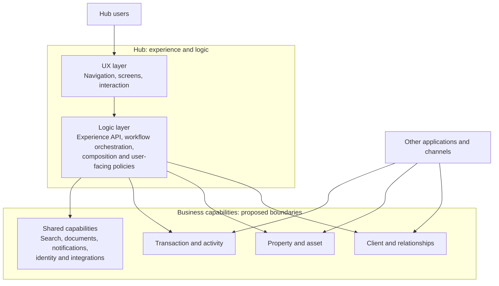

# Hub architecture modernization strategy

**Status:** Proposed target direction for discussion, not an approved design  
**Date:** 2026-11-24  
**Audience:** Business, architecture, product and technology leadership

## The opportunity

Transform Hub from a broad application that contains customer, property and
transaction capabilities into a **user experience and workflow layer**
that brings independently owned business capabilities together.

The strategic change is not simply to upgrade the technology. It is to make
client, property/asset and transaction capabilities reusable outside Hub, with
clear ownership of their business rules and data. Hub would remain the place
where users navigate and complete their work across those capabilities.

This is a proposed direction, not a claim that the current application is
already organized or deployed in this way. In this document, **client
capability** means business clients, contacts and relationships; the
**frontend** means the Angular user interface. If “client” was intended to
mean only the frontend, the client-domain separation should be revisited.

## Current position

Source and existing documentation indicate:

- The frontend is an Angular application calling a broad ASP.NET Web API.
- The API targets **.NET Framework 4.8**, with shared domain and data-access
  libraries, SQL Server, search, integrations and background jobs.
- Contact, property, activity, requirement, offer and tenancy functions exist
  in the same overall Hub application. Activities and tenancies connect
  property and people across a business transaction.
- Some asynchronous integration already exists through WebJobs, queues and
  Service Bus; this does not by itself establish independent domain ownership.
- The deployed topology, authoritative data ownership, service boundaries
  and production constraints still need confirmation.

See the [current architecture](../Architecture%20%26%20Infrastructure/architecture-blueprint.md)
and [core domain](../Core%20Business%20Domain/CORE-DOMAIN.md). The detailed
[modernization and performance assessment](./hub-modernization-and-performance-assessment.md)
provides supporting engineering evidence.

## Proposed target state

The boxes are **logical boundaries**, not a commitment to deploy a separate
microservice or database for each one. The capability boundaries, their data
owners and any existing enterprise systems must be agreed before selecting
deployment and storage models.

### What stays in Hub

| Layer | Responsibility | Not its responsibility |
|---|---|---|
| **UX** | Screens, navigation, accessibility, interaction, presentation validation and user feedback. | Owning authoritative client, asset or transaction data; directly accessing another capability's database. |
| **Logic** | Experience-facing API, user-specific composition, journey orchestration, cross-capability coordination, and translating capability outcomes into a coherent experience. | Duplicating the authoritative business rules of each capability, or becoming a second system of record. |

Hub can keep experience-specific state, such as user preferences or an
in-progress draft, where ownership is explicit. Security and authorization
remain enforced at both the experience boundary and the owning capability.
Business-critical workflow coordination may sit in a dedicated process
component rather than the Hub logic layer if other channels must initiate it.

### Candidate capability boundaries

| Capability | Candidate ownership | Examples of interactions | Important decisions |
|---|---|---|---|
| **Client and relationships** | Client/contact and company identity, relationships, and potentially consent. | Hub retrieves a client, links them to an instruction and displays relevant activity. | Is there an existing enterprise client master? Who owns company relationships, consent and duplicate resolution? |
| **Property and asset** | Property identity, address, characteristics and relevant asset relationships. | Hub finds an asset and associates it with a transaction. | Are property and asset the same business concept? Who owns ownership, property management and reference data? |
| **Transaction and activity** | Candidate home for instructions, activities, offers and progression of a transaction. | Hub initiates an activity and coordinates its parties, offers and status. | Are sales and lettings one boundary? Who owns requirements, matching, tenancies and chain transactions? |
| **Shared capabilities** | Candidate services for documents, search, notifications, identity and external integrations. | Hub composes a search result or shows a document and notification. | Which already exist outside Hub, who owns them and which information may be shared? |

These are hypotheses for domain workshops, not allocations of existing
systems or teams. Relationships such as ownership, tenancy, consent and
matching cross boundaries and need explicit authoritative ownership.

## Strategic step changes

| Step change | From | To | Why it matters | Main trade-off |
|---|---|---|---|---|
| **1. Modernize the runtime** | ASP.NET Web API on .NET Framework 4.8. | A supported modern **.NET / ASP.NET Core** target, selected at implementation time. | Current platform capabilities, a maintainable support path and improved options for hosting, observability and scaling. | Framework, libraries, hosting, identity, serializers and jobs are not a simple in-place version change; performance gains require measurement. |
| **2. Decouple the frontend** | Angular and a broad Hub API are released as parts of the same application landscape. | A separately deployable frontend consuming a stable, experience-facing API. | UI and backend can evolve and release more independently; the same capabilities can support other channels. | Requires contract/version discipline, compatible release sequencing and coordinated identity and error handling. |
| **3. Separate client capability** | Client/contact behaviour and data are part of the wider Hub domain. | A clearly owned client capability exposed through contracts; use an existing authoritative enterprise capability if appropriate. | Other applications can reuse trusted client information and rules without depending on Hub screens. | Data quality, consent, ownership, authorization and duplicate resolution must be settled. |
| **4. Separate property/asset capability** | Property/asset functions are implemented within Hub. | A reusable property/asset capability with an agreed system of record and lifecycle. | A consistent asset view can support transactions and other applications. | Existing property identifiers, ownership relationships and integrations may be deeply coupled to Hub. |
| **5. Separate transaction capability** | Activities, offers, tenancies and related workflows are implemented in the broader Hub domain. | One or more transaction capabilities, with authoritative lifecycle rules and clear links to clients and assets. | Transaction behaviour can evolve independently and be reused beyond one UI. | Transaction boundaries and cross-domain consistency are complex; splitting too early can create distributed failure modes. |
| **6. Turn Hub into a journey orchestrator** | Business functions, integrations and presentation logic are combined across the platform. | A focused UX and logic layer composing capability APIs and orchestrating user journeys. | Clearer accountability, a simpler experience layer and faster channel evolution. | A new central bottleneck or duplicated rules must be avoided; some workflows may belong outside Hub. |
| **7. Separate data ownership and integration** | Shared persistence and internal dependencies need further mapping. | Each capability has a single authoritative writer and published contracts; shared views are derived and rebuildable. | Independent change, clearer data accountability and reduced direct database coupling. | Data migration, reporting joins, consistency, events and operational recovery require substantial design. |
| **8. Modernize operational foundations** | Existing queues, jobs, tests and telemetry are present, but production guarantees are not established. | Consistent observability, service objectives, security, automated deployment and recoverable asynchronous processing. | Independent capabilities can be supported and changed safely. | More operational responsibility and tooling; avoid distributing components beyond the organization's ability to support them. |

## Architecture choices

### Deployment model

| Option | Description | Suitable when | Limitation |
|---|---|---|---|
| **A. Modernize together** | Move to modern .NET while retaining a single application and database. | Runtime support is the immediate driver and domain boundaries are not ready. | Technology improves, but capability reuse and independent change remain limited. |
| **B. Modular platform** | Define client, asset and transaction modules with explicit contracts, initially deployed together or in a small number of components. | Boundaries need proving without introducing unnecessary distributed-system complexity. | Independent scaling and deployment are limited until a module is extracted. |
| **C. Independently deployed capabilities** | Deploy selected capabilities separately with owned data and contracts. | Boundaries, teams, business value and operating capabilities are established. | Greater delivery and operational complexity, latency, consistency and failure-handling requirements. |

**Suggested approach:** start with **B**, use **A** selectively for necessary
runtime changes, and move individual capabilities toward **C** only when a
specific business need justifies it. Existing enterprise services may already
provide a capability; adopting them can be preferable to building another.
These options can be combined rather than applied as a single switch.

### Data and communication

- Agree one system of record and one authoritative write path for each data
  item before migration; neither Hub nor a search index should silently become
  a competing source of truth.
- Use synchronous APIs where an immediate authoritative answer is needed;
  use events for notifications and derived views where delayed consistency is
  acceptable. Event publication, retries, deduplication, ordering and recovery
  must be designed explicitly.
- Compose read views for cross-domain screens and reporting where useful, with
  defined freshness, access controls and rebuild procedures. Avoid
  cross-capability database writes or shared-database joins as a permanent
  integration contract.
- Make cross-domain invariant ownership explicit. Where a single atomic
  transaction is not possible, agree acceptable intermediate states,
  failure handling, compensation and reconciliation with business owners.
- Treat authorization, consent, audit, data retention and personal-data
  handling as end-to-end responsibilities, not just frontend checks.

### Example: an instruction against a property

1. Hub UX lets a user select a client and a property, then initiate an
   instruction.
2. Hub logic obtains the required client and property information through
   their agreed capability contracts and sends the instruction request to the
   transaction capability.
3. The transaction capability validates and owns the instruction lifecycle;
   client and asset capabilities remain authoritative for their own data.
4. On completion, a published event can update authorized search, reporting
   and notification views. The user sees the outcome and any pending state.

This is illustrative. The real workflow, required validation, transactional
boundaries and acceptable delay require business and technical approval.

## Incremental migration

| Stage | Outcome | Decision or exit gate |
|---|---|---|
| **1. Agree the target** | Map business capabilities, consumers, current integrations, data ownership and the critical journeys. Choose a first slice and owners. | Approve boundaries, system-of-record candidates, non-functional requirements and the business case. |
| **2. Establish the seams** | Define stable experience and capability contracts; capture existing behaviours in regression tests; establish telemetry, identity, release and rollback. | Prove a representative current workflow and its authorization can be tested end to end. |
| **3. Pilot modern .NET and frontend separation** | Route a low-risk vertical slice through a modern ASP.NET Core component and experience API while the rest remains on the existing platform. Frontend deployment can be separated without rewriting the UI. | Demonstrate compatibility, observable performance, independent release and safe rollback; select supported runtime and hosting. |
| **4. Prove one capability boundary** | Choose the first capability based on ownership clarity, reuse and risk; introduce its contracts and an anti-corruption adapter around legacy behaviour. | Prove real consumer reuse and operational ownership; confirm the data authority and cutover plan before moving writes. |
| **5. Migrate data and workflows by slice** | Move functionality, integrations and data incrementally. Maintain a single authoritative writer per entity; migrate/reconcile data and switch routing in a controlled cutover. | Validate completeness, permissions, integrations, events, reporting and business outcomes. Rehearse rollback and reconciliation; do not assume writes made after cutover can simply be rolled back. |
| **6. Reduce legacy Hub** | Remove retired paths only after consumer migration and retention requirements are met; repeat for further capabilities. | Confirm no remaining dependencies, consistent data, operational readiness and measurable value before decommissioning. |

The order of client, asset and transaction extraction is **not predetermined**.
Choose using business ownership, reuse opportunities, dependency mapping,
data quality, risk and the ability to prove an end-to-end journey.

## Expected outcomes and how to test them

| Desired outcome | Evidence of success |
|---|---|
| Hub becomes a focused experience and logic layer | Its responsibilities and remaining data are documented; client, asset and transaction rules have agreed owners and contracts. |
| Business capabilities are reusable | At least one real consumer other than the original Hub path uses a capability without direct access to Hub's database. |
| Changes are safer and faster | Compare deployment lead time, release coupling, change failure rate and rollback time with the baseline. |
| User experience and performance improve | Measure agreed end-to-end journey latency, availability and error rates before and after; distributed calls do not automatically improve performance. |
| Technology remains supportable | Each runtime, library and hosting dependency has an owner and a current support/upgrade plan. |
| Data and business behaviour remain trustworthy | Reconciliation, audit, access controls and critical workflow regression tests pass through migration and recovery. |

## Decisions needed

1. Does **client** mean the business client/relationship capability, the
   frontend, or both?
2. Are client, property/asset and transaction capabilities intended to be
   enterprise-wide products, and do authoritative services already exist?
3. What exactly belongs in the Hub **logic layer**: experience composition
   only, cross-domain orchestration, or business process ownership too?
4. Who owns each capability, its data and the relationships between them?
   In particular, where should requirements, matching, consent and tenancies
   belong?
5. What must be independently deployable or scalable, and what can remain
   modular within a shared deployment?
6. Which journey provides the best first slice, and what are the acceptable
   consistency, availability, cost and migration risks?

Resolve these with business and technology owners before committing to a
target topology, migration schedule or delivery estimate.
