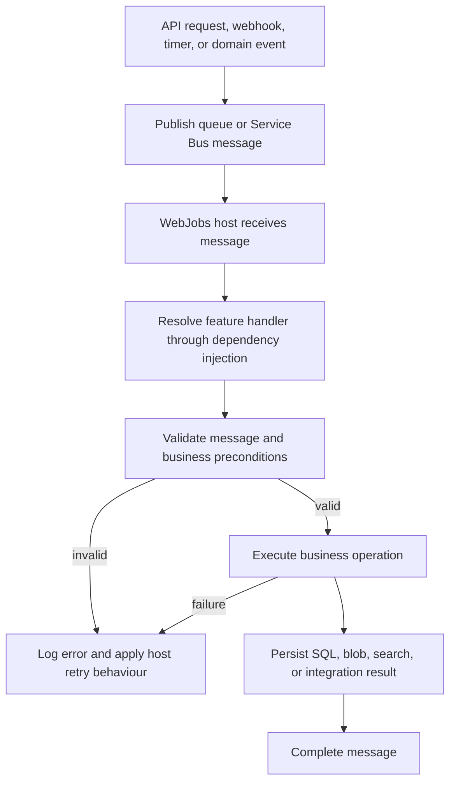
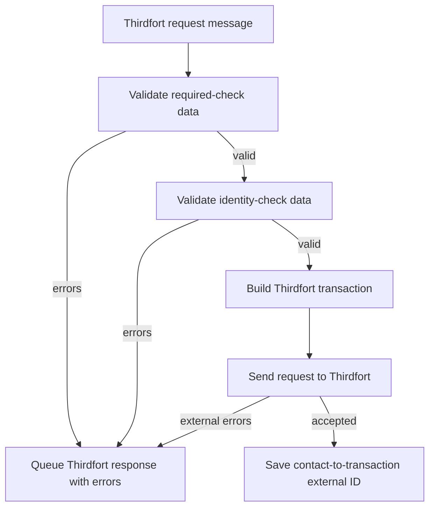
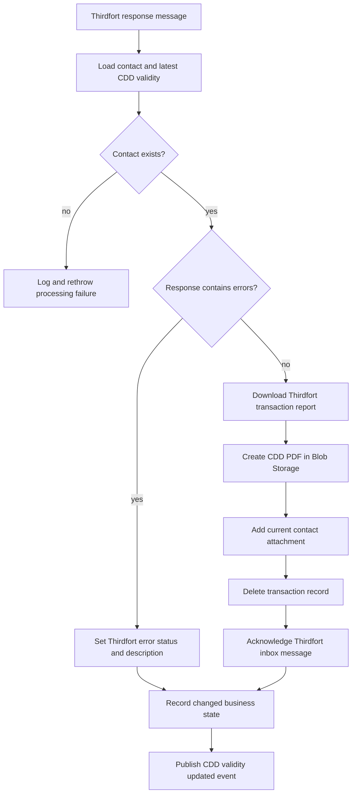

# Hub process flows

## Status

These are source-derived first-pass flows. They document confirmed behaviour for the Thirdfort asynchronous journey and a generic Hub asynchronous processing pattern. Additional flows are required for the main property, contact, tenancy, document, notification, and feed journeys.

## Generic asynchronous processing

## Thirdfort request

Source: `src/WebJobs/KnightFrank.Antares.WebJobs.Thirdfort/MessageHandlers/ThirdfortRequestQueueMessageHandler.cs`.

## Thirdfort response and report

Source: `src/WebJobs/KnightFrank.Antares.WebJobs.Thirdfort/MessageHandlers/ThirdfortResponseQueueMessageHandler.cs`.

## Process documentation gaps

- Entry points for the main property, contact, tenancy, document, and notification processes.
- User-visible outcomes and SLAs.
- Retry, poison-message, and dead-letter paths for each process.
- Compensating actions when an external service succeeds but local persistence fails.
- Process owners and operational runbooks.

